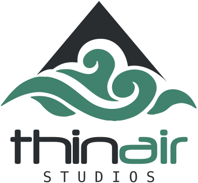

<picture><source media="(prefers-color-scheme: dark)" srcset="thinair-logo-dark.svg"></picture>

<b>We build software for companies, and our first game.</b> A two-person studio in Sarajevo.

### What we build

- **Web platforms**: dashboards, customer portals and internal tools on Laravel, Vue and React.
- **Mobile apps**: React Native, with native iOS and Android code where it matters.
- **Backends and APIs**: realtime updates over WebSockets, document generation and integrations.
- **Data and AI**: reporting over millions of rows and AI features that answer from your own data.

### The game

Our first game is an isometric roguelike, built in Godot. No screenshots yet: the trailer comes first.

### Contact

hello.thinairstudios@gmail.com · [LinkedIn](https://www.linkedin.com/company/thinairstudios/) · [thinairstudios.dev](https://thinairstudios.dev)
